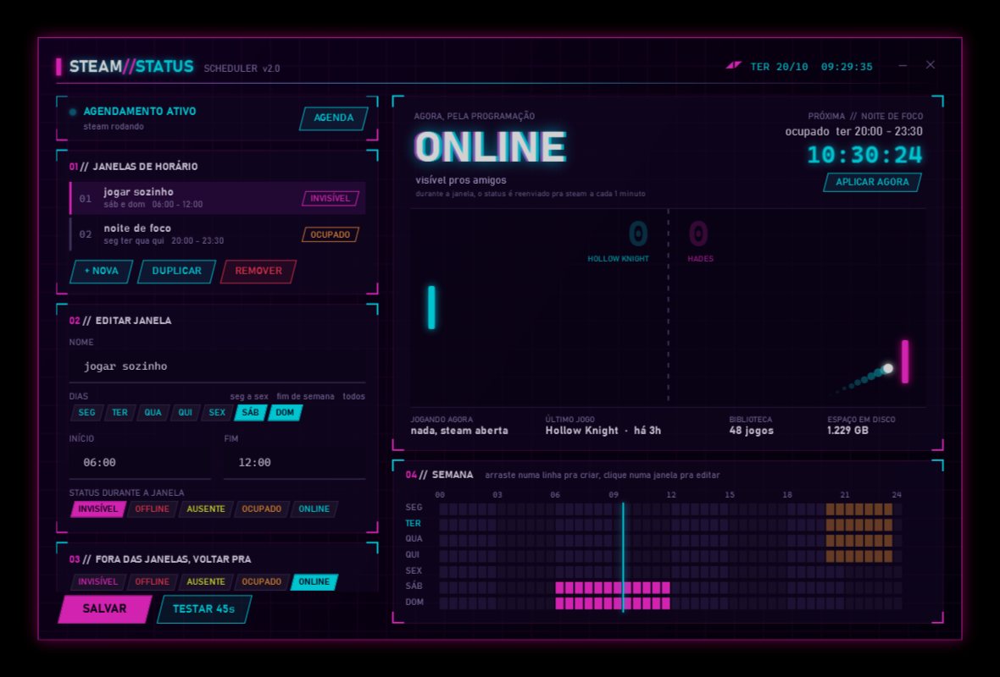

# Steam Status Scheduler

**Fique invisível na Steam nos horários que você escolher, automaticamente.**

Joga sozinho sábado de manhã? Não quer convite durante o trabalho? Marca o horário uma vez e esquece: a Steam troca de status sozinha e volta pra online quando o horário acaba.

## Instalar (1 linha)

Abra o **PowerShell** (tecla Windows, digite `powershell`, Enter), cole a linha abaixo e aperte Enter:

```powershell
iwr https://github.com/IvanPJ/steam-status-scheduler/archive/refs/heads/main.zip -OutFile $env:TEMP\sss.zip; Expand-Archive $env:TEMP\sss.zip $env:TEMP\sss -Force; & "$env:TEMP\sss\steam-status-scheduler-main\Instalar.bat"
```

Pronto. A janela de configuração abre sozinha no final.

<details>
<summary>Prefere sem comando? Instale pelo ZIP</summary>

1. [Baixe o ZIP](https://github.com/IvanPJ/steam-status-scheduler/archive/refs/heads/main.zip) e extraia em qualquer pasta.
2. Dê duplo clique em **`Instalar.bat`**.
3. Se aparecer a tela azul "O Windows protegeu o computador", clique em **Mais informações** e depois em **Executar assim mesmo**. Isso aparece porque o arquivo veio da internet.

</details>

Funciona no Windows 10 e 11. Não precisa de administrador nem de nenhum outro programa além da Steam.



## Usar

Abra pelo Menu Iniciar: tecla Windows, digite **Steam Status Scheduler**, Enter.

1. **Arraste** numa linha da grade da semana pra criar um horário. Ou clique em `+ NOVA`.
2. Ajuste o **nome**, os **dias** e o **início e fim**.
3. Escolha o **status** durante o horário.
4. Clique em **SALVAR**. Pode fechar a janela.

| Status | O que seus amigos veem |
|---|---|
| **INVISÍVEL** | Você aparece offline, mas continua vendo a lista e recebendo mensagens. É o mais usado. |
| **OFFLINE** | Você sai do chat de amigos de verdade. |
| **AUSENTE** / **OCUPADO** | Você aparece online com esse aviso. |
| **ONLINE** | Normal. |

Em **Fora das janelas, voltar pra** você escolhe o status de quando o horário acaba. Normalmente é ONLINE.

## Perguntas rápidas

**Precisa deixar alguma coisa aberta?**
Não. Quem dispara é o Agendador de Tarefas do próprio Windows. A janela de configuração pode ficar fechada e continua valendo depois de reiniciar o PC. Só a Steam precisa estar aberta.

**Se eu ficar online na mão durante o horário?**
Em até 1 minuto ele volta pro status do horário. Fora dos horários nada é forçado.

**E se a Steam estiver fechada?**
Durante um horário, ela abre minimizada na bandeja já com o status certo.

**E se o PC estiver desligado no horário?**
Assim que ligar, o status do horário é aplicado.

**Acabei de criar um horário que já começou.**
Ao salvar, o status já é aplicado. Também tem o botão **APLICAR AGORA**.

**Como atualizo?**
Rode a linha de instalação de novo. Seus horários são mantidos.

**Como desinstalo?**
Abra a pasta `%LOCALAPPDATA%\SteamStatusScheduler` (cole isso na barra do Explorer) e dê duplo clique em `Desinstalar.bat`. Ele remove tudo e te deixa online.

**Meu antivírus reclamou.**
Não fica nenhum programa rodando escondido: são só tarefas do Windows chamando a própria Steam. O código é aberto, dá pra ler cada arquivo. Se mesmo assim bloquear, adicione a pasta `%LOCALAPPDATA%\SteamStatusScheduler` às exceções e instale de novo.

## Como funciona

Cada horário vira duas tarefas na pasta `SteamStatusScheduler` do Agendador de Tarefas do Windows:

- **início**: roda `steam.exe -silent steam://friends/status/invisible` (ou o status escolhido) e repete a cada 1 minuto até o fim do horário;
- **fim**: roda o mesmo comando com o status de "fora das janelas".

1 minuto é o menor intervalo do Agendador do Windows. Um intervalo menor exigiria um programa sempre rodando em segundo plano.

A tela de configuração é uma janela nativa do Windows feita em PowerShell + WPF. O Pong e a faixa de informações usam só os manifestos da sua biblioteca de jogos (nome, tamanho e última vez jogado). Nenhum dado de conta ou login da Steam é lido.

| Arquivo | Pra quê |
|---|---|
| `Instalar.bat` / `install.ps1` | Copia pra `%LOCALAPPDATA%\SteamStatusScheduler`, cria as tarefas e o atalho |
| `Configurar.ps1` | A janela de configuração |
| `Tarefas.ps1` | Transforma o `config.json` em tarefas do Windows |
| `config.json` | Seus horários |
| `Desinstalar.bat` / `uninstall.ps1` | Remove tudo |

## Licença

MIT. Faça o que quiser.
